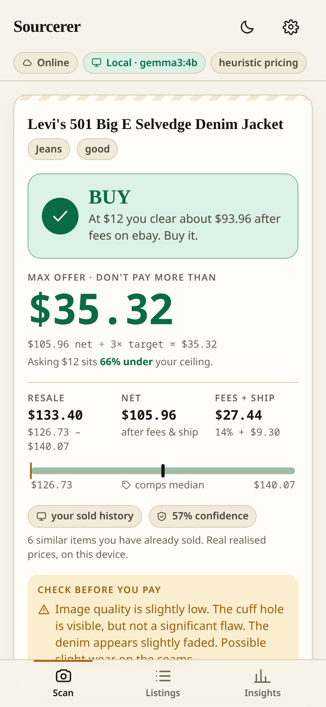
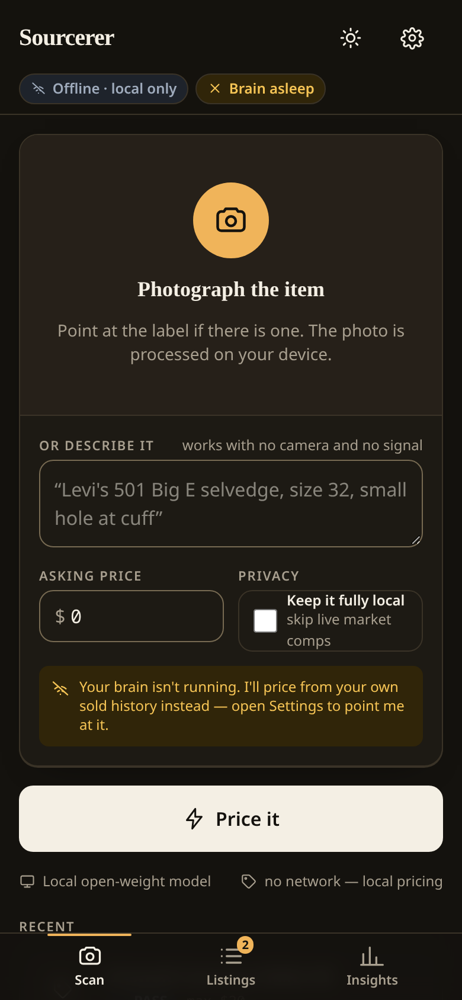
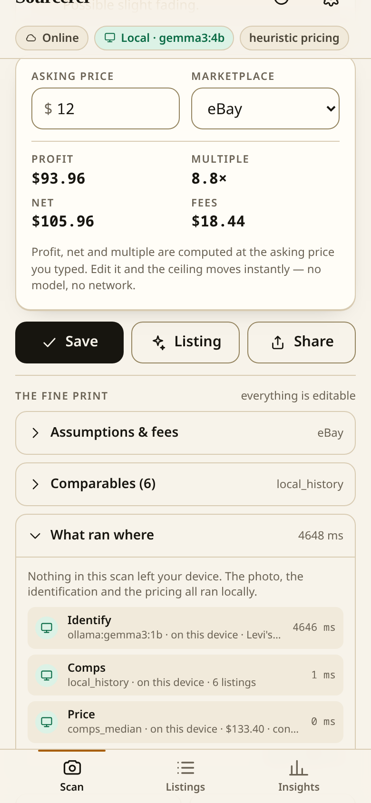
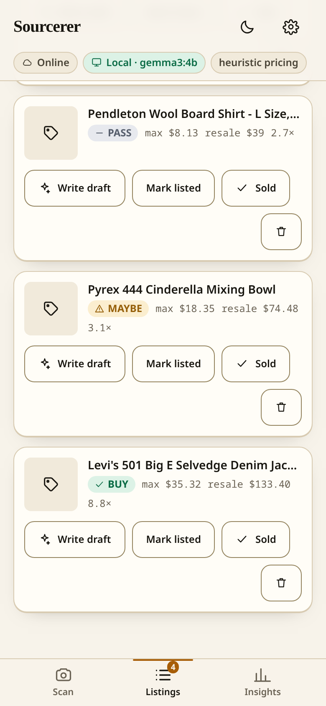
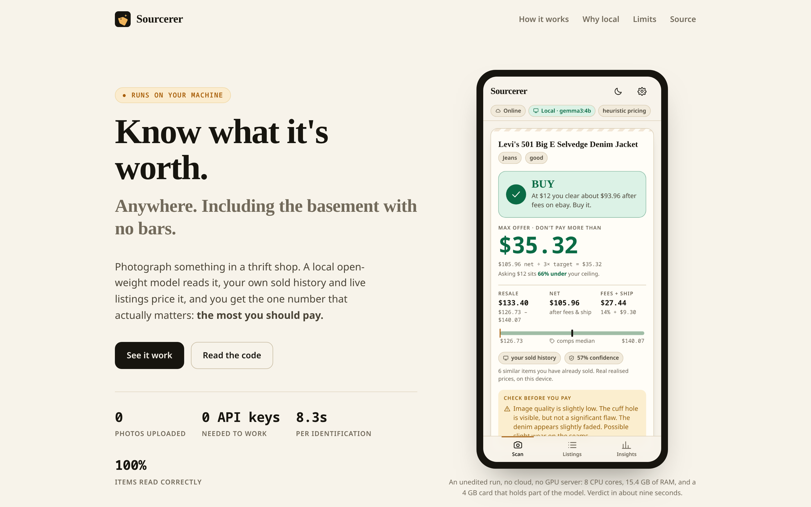
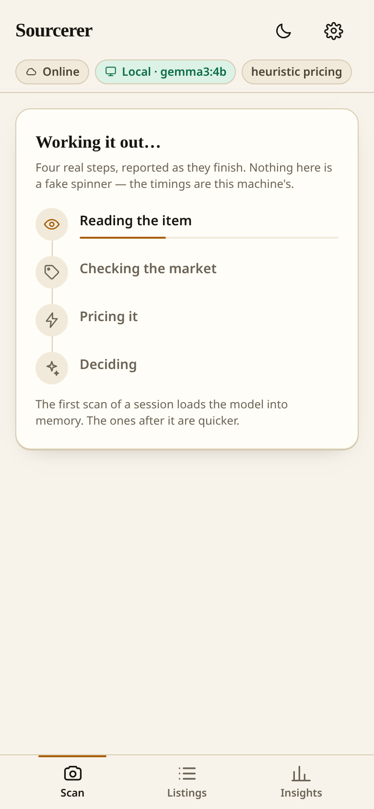
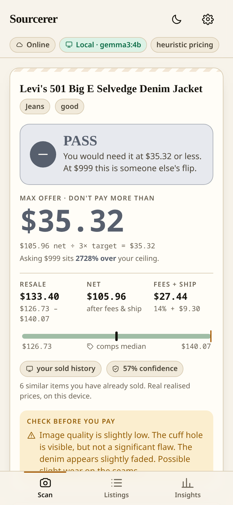
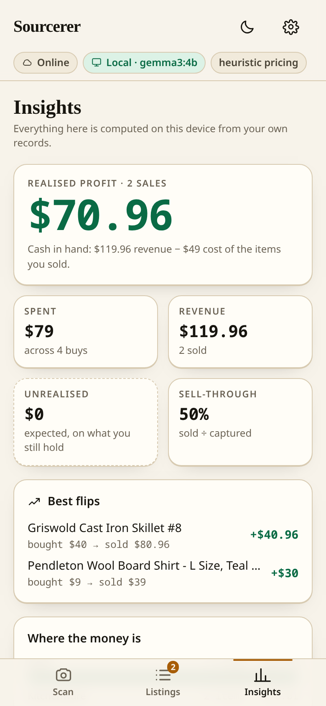
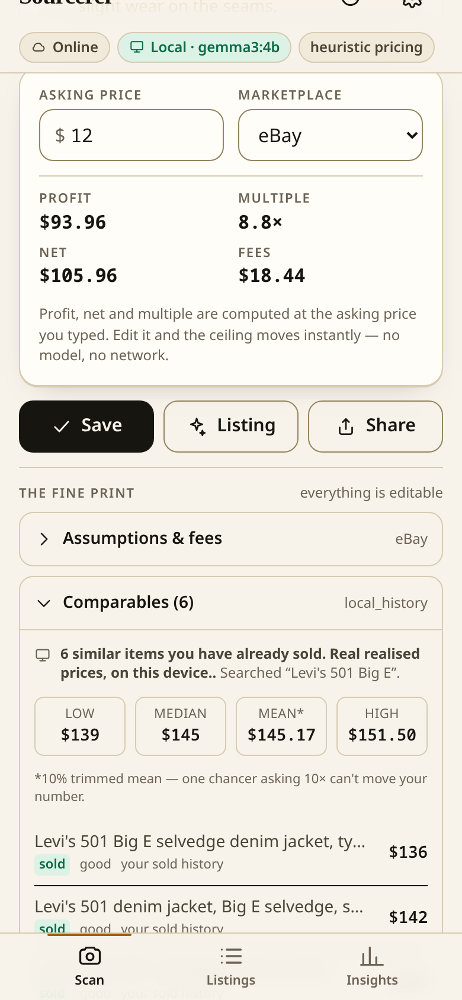

# Sourcerer

**Know what it's worth. Anywhere.**

An offline-first sourcing copilot for resellers. Photograph an item and a multimodal
open-weight model running *on your own machine* identifies it, prices it against the
market, and tells you the most you should pay — in a thrift-store basement, in the back
room of an estate sale, in a warehouse with no bars on your phone.




**Landing page:** <https://sourcerer-ochre.vercel.app> · **Code:** <https://github.com/ItsPriyamSri/sourcerer>

```
┌──────────┐   ┌──────────────────────────┐   ┌─────────────────┐   ┌──────────────┐
│ photo or │ → │ Gemma 3 (local, Ollama)  │ → │ comps + fee math│ → │ BUY / MAYBE  │
│  a note  │   │ identify · read labels   │   │ SerpApi or your │   │ PASS + max   │
│          │   │ no network required      │   │ own sold history│   │ offer price  │
└──────────┘   └──────────────────────────┘   └─────────────────┘   └──────────────┘
```

---

## The problem, stated honestly

A reseller's decision moment is **offline and time-pressured**. There is no wifi in a
thrift-store basement and no time to wait for a server round trip while your hands are
full. Every pricing tool that requires the network fails at exactly the moment it is
needed — not by being slow, but architecturally.

That is why this project is built the way it is. Open-weight AI on your own device is
not a nice-to-have for this problem. **It is the only architecture that solves it.**

Sourcerer keeps working with:

- no internet connection
- no API keys of any kind
- no per-scan cost
- no photos leaving your machine

and gets *sharper* when you add the network and a few keys back. Degradation is part of
the design, not an error path.

<p align="center">

</p>
<p align="center"><sub><b>Network off, for real.</b> The browser's network was disabled before this shot. The chip reads <b>Offline · local only</b>, the brain is unreachable (<b>Brain asleep</b>), and the capture screen still renders — the service worker holds the app shell. Nothing here is a simulated offline flag.</sub></p>

---

## What it looks like

<table>
<tr>
<td width="33%"><br><sub><b>The verdict.</b> One dominant signal, the max offer in the largest type on the screen, and the range it came from.</sub></td>
<td width="33%"><br><sub><b>The receipt.</b> Every scan records which provider ran each step and whether anything left the device. "Photos never leave your machine" is a field you can read, not a promise.</sub></td>
<td width="33%"><br><sub><b>The other half.</b> Captures land here priced, each with its own verdict; one tap writes the title, description, tags and price with the local model.</sub></td>
</tr>
</table>

<p align="center">

</p>
<p align="center"><sub><b>The public page</b> for the <code>.tech</code> category — live at <a href="https://sourcerer-ochre.vercel.app">sourcerer-ochre.vercel.app</a>. It embeds these same captures and reads its headline numbers from <code>landing/evidence.json</code>, which the capture writes straight from the eval — so the page cannot drift from the evidence the way a hand-typed statistic would.</sub></p>

---

## What it actually does

**Scan.** Point the camera at an item — a label, a maker's mark, a jacket on a rack — or
just type a description. The app downscales the photo locally, runs it through Gemma 3
on your machine, and streams the pipeline stages back as they happen (`Reading →
Checking the market → Pricing → Deciding`). You get a verdict card:

- one dominant signal — **BUY / MAYBE / PASS** — with an icon, a word and a colour, so
  it reads at arm's length and survives colour blindness
- **the max offer price**, in the largest type on the screen
- an expected resale range, the multiple, and the profit after real fees
- where the number came from, always: `12 live comps` or `your sold history`

Then type the price on the tag and the whole thing re-prices **instantly and offline**,
because the fee arithmetic is deterministic pure TypeScript shared by the server and the
browser — not a model call.

<table>
<tr>
<td width="50%"><br><sub><b>Named stages, not a spinner.</b> The pipeline streams each real stage as it starts and finishes. On CPU inference the wait is part of the experience, so the app shows what it is doing and how long each step took rather than hiding it behind an animation.</sub></td>
<td width="50%"><br><sub><b>It says no.</b> Set a tag price above the ceiling and the verdict flips to PASS with the ceiling unchanged — recomputed on-device from the same pure arithmetic, with no model call and no network.</sub></td>
</tr>
</table>

**Listings.** Everything you captured is in a queue. Tap once and your local model
writes the title, description, tags and price for each item. Copy them one at a time or
export the lot to CSV. This is the 11pm typing grind, deleted.

**Insights.** Realised vs. unrealised profit, sell-through, forecast accuracy, and which
categories actually pay. Computed locally with the same pure functions the server uses,
so the numbers can never disagree.

<p align="center">

</p>
<p align="center"><sub><b>Computed here, from your records.</b> Realised profit comes only from sales you logged; unrealised is a projected number, so it gets a dashed tile and says so. The tile reads <b>$0</b> because the rollup counts only items marked <code>bought</code> or <code>listed</code>, and these two are still marked <code>sourced</code> — while the Listings screen reports <b>$120.71</b> of expected profit from the same two held items. The tile's own label, "expected, on what you still hold", does not match that definition. This cross-screen disagreement is a known defect in the rollup, recorded in <a href="docs/media/CAPTIONS.md">the captions</a> rather than papered over.</sub></p>

---

## Quickstart

```bash
git clone <this repo> && cd sourcerer
bash scripts/setup.sh          # checks the toolchain, installs, pulls Gemma 3
```

Then two terminals:

```bash
pnpm --filter @sourcerer/brain dev     # http://127.0.0.1:8787
pnpm --filter @sourcerer/web dev       # http://localhost:3000
```

Open `http://localhost:3000` on your laptop, or on your phone by hitting your laptop's
LAN address — and add it to your home screen. It is a PWA and it works offline.

### First, the zero-key path

**No keys are required.** With zero configuration you get local Gemma identification,
local comps from your own sold history, and local heuristic pricing. To see it work
immediately without owning anything, load the sample data:

```bash
curl -X POST "http://127.0.0.1:8787/demo/seed?reset=1"
```

That reads [`fixtures/sold.json`](fixtures/sold.json) — thirty-two **synthetic** records,
labelled as sample data everywhere they appear, so a clean clone can exercise the
offline pricing path and the Insights screen. They are not real sales and not market
data. The four items the evidence capture scans each have several sales behind them, so
the demo shows the app with enough history to be sure of itself rather than one lonely
comparable.

The `reset=1` is load-bearing. Without it the endpoint appends, so every call leaves a
longer history than the last and the same scan prices differently — which is how the
screenshots in this repo spent a while showing a comp set that grew from six rows to
fifteen across otherwise identical runs.

### Then, sharpen it

Each of these is additive, and each degrades gracefully when absent:

| Add | You get | File |
|---|---|---|
| `SERPAPI_API_KEY` | live eBay listing comps instead of your own history | [`docs/KEYS.md`](docs/KEYS.md) |
| `TABPFN_TOKEN` | a price model fitted on *your* sales | [`docs/KEYS.md`](docs/KEYS.md) |
| `DATABASE_URL` (pgvector) | "have I bought one of these before?" | [`docs/KEYS.md`](docs/KEYS.md) |
| `ELEVENLABS_API_KEY` | dictate an item; hear the verdict | [`docs/KEYS.md`](docs/KEYS.md) |
| `SENTRY_DSN` | a trace per pipeline stage, plus error capture | [`docs/KEYS.md`](docs/KEYS.md) |
| `BACKBOARD_API_KEY` | the same agent on open weights, hosted, for machines with no GPU | [`docs/KEYS.md`](docs/KEYS.md) |

`GET /capabilities` always tells the truth about what is live right now, and the app
surfaces the same thing in Settings → *What runs where*.

### Requirements

| | |
|---|---|
| Node | 22.18+ |
| pnpm | 10+ (this repo is pnpm-only; no `package-lock.json`, no npm) |
| Ollama | 0.40+ with `gemma3:4b` and `gemma3:1b` (plus `llama3.2:3b` for the advisor's tool loop) |
| RAM | ~6 GB free for the 4B vision model. A GPU is nice; CPU works, just slower. |

---

## Degradation matrix

This is the product thesis in tabular form. Nothing in this table throws.

The local models are present in every column — they are on your disk, not on a network — so
the first column is not a crippled version of the app. It is the app, with the parts that need
someone else's server switched off. (A browser with no network at all is the rarer case, and it
still answers: `apps/web/src/lib/offline.ts` prices the item from your own sold history, tagged
`estimate` so it can never be mistaken for a live comp.)

| Capability | No network, no keys | + network | + keys |
|---|---|---|---|
| Identify from a photo | Gemma 3 4B, local | same | same |
| Identify from text | Gemma 3 1B, local | same | same |
| Market comps | your own sold history | sold history | live eBay listings (SerpApi) |
| Price estimate | condition-adjusted comps | same | TabPFN model on your sales |
| Verdict + max offer | deterministic, local | identical | identical |
| Listing draft | local model, template if it is down | local model | local model |
| Advisor | local tool-using model, deterministic answer if it is down | same | same, or the same agent on Backboard's hosted open weights |
| Voice | — | — | ElevenLabs in/out |
| Tracing | — | — | Sentry spans around identify/comps/price |
| Similar items | — | — | pgvector, when `DATABASE_URL` is set |
| Background reprice | — | needs Temporal running | same |

Full failure behaviour per layer is in [`docs/ARCHITECTURE.md`](docs/ARCHITECTURE.md) §7.

---

## How it's built

```
sourcerer/
├─ packages/shared/        pure domain core — types, fee math, comps stats, verdict, zod, prompts
├─ apps/brain/             Hono + Mastra API, providers, workflow, durable jobs
│   ├─ core/steps.ts       the pipeline: identify → comps → price → verdict → listing
│   ├─ providers/          llm · comps · pricing · vector · voice · tracing (all optional, all swappable)
│   ├─ mastra/             tools, two agents, a 4-step typed workflow, LibSQL memory
│   ├─ durable/            Temporal reprice workflow: activities, worker, client
│   └─ eval/               the hand-labelled set and the eval runner
└─ apps/web/               Vite + React PWA — scan, listings, insights
```

### The finding: the model reads the item, plain code decides the price

A small model is the right instrument for reading a blurry label in bad light, and the
wrong one for solving for a margin. So the system is split, permanently:

- **The model identifies** — fuzzy, tolerant of bad light, occasionally wrong in
  interesting ways.
- **Plain arithmetic decides the money** — `decideVerdict`, `maxOfferFor` and
  `computeEconomics` in [`packages/shared`](packages/shared/src/economics.ts) are pure,
  unit-tested, and identical in the server and the browser.

A 4B model should never be trusted with your margin. Here, it never is: the only number
it produces is an estimate of what the item sells for, and even that is anchored to comps
whenever comps exist.

The full write-up — including the eval, the prompt-iteration table and the failure I left
in — is in **[`docs/POST.md`](docs/POST.md)**.

**Every integration degrades instead of failing.** Providers sit behind small interfaces.
`llmChat()` walks a provider chain; comps fall back from live market data to your own
sold history; pricing falls back from TabPFN to condition-adjusted comps. At no point
does a missing key produce a broken screen.

**Provenance is part of the data model, not the copy.** Every `Comp` is tagged `sold` or
`asking`; every comps result is tagged `live`, `local_history`, `cache` or `estimate`;
every scan returns a `ran[]` log of which provider executed each step and whether data
left the device. The UI renders those fields directly, which is why the privacy claim is
inspectable rather than aspirational.

<p align="center">

</p>
<p align="center"><sub><b>Every comp is tagged.</b> With no market key configured, comps come from your own sold history and each row is labelled <code>sold</code>; the panel says so in words. Point it at a live-comps key and the same rows read <code>asking</code>, with the haircut stated on the panel — never silently relabelled as a sale.</sub></p>

### A real engineering decision: eBay retired its sold-comps filter

When this was built (October 2026), eBay had moved completed listings behind a login and
the SerpApi `show_only=Sold` filter was retired with them. There is no sold-comps engine
to call.

The wrong move would have been to quietly return *asking* prices and label them "sold".
Instead: Sourcerer returns live asking prices tagged `kind: "asking"`, applies an
explicit, visible **`ASKING_TO_SOLD_FACTOR = 0.86`** haircut, says so in the UI, and puts
the whole thing behind a `CompsProvider` interface so a genuine sold-comps vendor can drop
in without touching the pipeline. A reseller who catches you lying about sold prices
never comes back; a reseller who understands the haircut trusts you more.

---

## Evidence

<!-- EVAL_TABLE_START -->
| Configuration | Emitted parseable JSON | Brand correct | Type correct | **Both** | Invented a brand | Median |
|---|---|---|---|---|---|---|
| `v1` prose prompt, no schema | 100% | 97% | 100% | **29/30** | 1/4 | 8.8 s |
| `v2` same prompt, + JSON schema | 100% | 100% | 100% | **30/30** | 0/4 | 8.6 s |
| `v3` full rules prompt, + schema | 100% | 100% | 100% | **30/30** | 0/4 | 8.5 s |
| `v4` v3 + anti-invention rules | 100% | 100% | 100% | **30/30** | 0/4 | 8.3 s |

Model `gemma3:4b`, temperature 0.1, 30 items, one machine, one afternoon.
<!-- EVAL_TABLE_END -->

Method: 30 items with a known brand and type, written by hand the way a person would type
them at a rack. Ground truth is the description itself, so the scoring is mechanical and
every failure can be checked by reading the row. Four prompt/schema configurations were
run against the same set. Raw output, including every wrong answer:
[`docs/evidence/identify-results.json`](docs/evidence/identify-results.json).

The Temporal durability evidence — a worker killed mid-sweep with `SIGKILL` and resumed —
is in [`docs/evidence/temporal/`](docs/evidence/temporal/):

```
items in the sweep                          : 12
worker #1 refreshed before the SIGKILL      : 3
worker #2 refreshed after the restart       : 9
distinct items across both worker logs      : 12
items refreshed twice (should be 0)         : 0
activity executions in the history          : 24  (expected 24 = 2/item)
workflow status right after the kill        : RUNNING
final result reported by the client         : done: 12/12 refreshed, 0 failed

PASS — the SIGKILL cost the run time and nothing else.
       No item was refreshed twice, and no activity was re-executed on replay.
```

The pacing between items is not a demo trick: it is a rate limit for a paid search API,
because a 200-item sweep will otherwise get you throttled. It also happens to make the
crash window observable, which is how the claim above was produced.

Reproduce both:

```bash
pnpm test                              # 101 unit tests, no model, no network
pnpm evidence:identify                 # the identification eval (needs Ollama)
bash scripts/temporal-durability-demo.sh   # the crash-and-resume proof
pnpm evidence:capture                  # every screenshot in docs/media, from the real app
```

---

## Tests

```bash
pnpm test          # 101 tests
pnpm typecheck     # all three packages
```

They cover the parts that decide whether someone makes money — fee arithmetic, the
max-offer solve, the verdict thresholds, trimmed-mean robustness to a single absurd
listing, clamping of hostile cost-model input — plus the JSON salvage that keeps a model
answering in prose from taking a whole scan down with it. No model is mocked, because
none of these need one.

Thirty-two of them cover the two integrations that no local run can reach, because both
need a key: the search request the app sends to SerpApi, and the message body it sends to
Backboard. "The tests pass" had said nothing about either, and both had already shipped a
defect that only a live call would have surfaced.

- SerpApi's `_ipg` accepts exactly 25, 50, 100 or 200 — it is not an arbitrary maximum.
  The configured 60 was not one of them, so the first live search would have failed outright.
- Backboard's per-turn instructions field is `system_prompt`. The first version folded the
  system prompt into `content` and sent the JSON schema in an `instructions` key, which
  Backboard does not define. An unknown field is ignored rather than rejected, so the call
  would have returned `200` and identified the item from the text *"Produce the JSON now."*

Neither defect was reachable by a typecheck, a build or a local scan — which is the point.
These tests pin the requests against the published contracts, so connecting a key is the
boring step rather than the debugging step.

Four more pin something the keyed group cannot: what the local matcher is allowed to call
a comparable. It used to accept any single shared word, so "wool" pulled a Woolrich
mountain parka into a Pendleton wool shirt's comp set and priced the shirt off a different
garment. It now requires two shared tokens, and the parka is a test case.

### The four integrations that only a live key can reach

The same exercise was then run against the rest of the keyed integrations, on the rule that
the published contract gets read rather than assumed. It found four more defects that a
typecheck, a build and a local scan had all passed over, plus two retired model ids:

- **TabPFN** returns regression quantiles quantile-major. Read row-major, `prediction[0]` is
  `[p10]`, which fails the "three values" check and drops into a ±20% band *around p10* —
  roughly 20% low on every prediction, with no error raised anywhere. Seven tests.
- **Tiger Data** hands you `...?sslmode=require`, and `pg` discards an explicit `ssl` object
  whenever the URL carries that parameter. Since pg 8.23 `require` means *verify-full*, so
  the connection dies at the TLS handshake against Tiger's self-signed free-tier certificate
  — before a single query runs, after which schema init fails and `/similar` quietly returns
  nothing forever. The parameter is now stripped and TLS decided explicitly. Seven tests.
- **ElevenLabs** retired `scribe_v1` on 2026-07-09, so the first transcription would have
  failed on the model id rather than on the audio; and `eleven_turbo_v2_5` is deprecated in
  favour of the flash tier. Two one-line corrections, no test needed.
- **Sentry** v11 removed `sendDefaultPii` and made an unset `dataCollection` collect genAI
  inputs, outputs and user info by default — the exact opposite of what the file's own
  privacy comment promised. The v10 options it used were being ignored silently.

Twelve further tests cover `pnpm keys:check`, which is what proves any of this live.

### Verified live, not just wired

Six integrations have now been pointed at something real rather than a contract: Gemma and
Temporal as documented above, plus four more.

- **SerpApi** — against a real account. The raw `POST /scan` response is committed at
  [`docs/evidence/serpapi-live.json`](docs/evidence/serpapi-live.json): **51 live eBay
  listings** for the query `brass bottle opener nautical`, and the scan log names the query
  it actually sent.
- **pgvector** — a local container, no cloud account needed. 32 items embedded through the
  real pipeline, then *"something to cook with in the kitchen"* returned Pyrex mixing bowls
  and a Griswold skillet. No shared keywords with the query, which is the whole point.
- **Backboard** — authenticated against a real account, which is where it got interesting:
  a Backboard run that fails returns **HTTP 200** with `status: "FAILED"` and the reason in
  `content`. This account's free credit is reserved for Memory & RAG, so every LLM run fails
  that way — and the pipeline read the sentence *"Your free credit is reserved for Memory &
  RAG, so it can't cover LLM chat"* as the item's title, then sent `misc Your free` to eBay
  as a live search query. Failed runs throw now, so `llmChat` falls through the provider
  chain to local Gemma and the scan comes back correct. Raw responses:
  [`docs/evidence/backboard-credit-wall.json`](docs/evidence/backboard-credit-wall.json).
- **ElevenLabs** — voice **in** verified live: `POST /v1/speech-to-text` with `scribe_v2`
  returns HTTP 200. Voice *out* is refused by the plan, not the code: the free tier answers
  `402 paid_plan_required` on library voices, default voice included. The key was also
  created *scoped*, which exposed a defect in the checker itself, below.

Doing that found defects, two of them silent:

- **Ollama moved its embeddings route.** `POST /api/embeddings` (`{prompt}` → `{embedding}`)
  was removed in Ollama 0.40 in favour of `POST /api/embed` (`{input}` →
  `{embeddings: [[…]]}`). The old request failed at the transport level, `embed()` returned
  null for every call, and every upsert stored a NULL vector — so "have I bought this
  before?" quietly fell back to keyword matching and the vector column stayed empty forever,
  with no error anywhere. Both shapes are read now.
- **Thirty-two concurrent embeds all timed out.** Ollama answers one request per model at a
  time, so the demo seed's simultaneous batch queue-jumped itself past the 8 s request
  timeout on every item and stored 32 NULL vectors. Embedding writes are serialised now.
- **The comps log mislabelled the network.** SerpApi sits behind the on-disk cache, and the
  cache describes itself as local — so a cache *miss*, which does go to the network, was
  logged as `provider: cache` / `locality: device`. That is the one line in the UI whose job
  is to say whether a query left the machine, and it said it had not. The result's own
  `source` decides the label now.
- **The key checker called a working key broken.** ElevenLabs now issues *scoped* keys, and a
  scoped key answers `401` on `GET /v1/user` — a route the app never calls. So
  `pnpm keys:check`, the one command whose entire job is telling the truth, reported a valid
  key as rejected. It reads the missing scope off the error body and then probes the call the
  app actually makes, which is a harder thing to get wrong than a status code.

---

## Honest limits

- **It is slow on CPU.** About nine seconds to identify an item from text once the model
  is warm, thirty to forty seconds from a photo, and roughly seventy-five seconds on the
  very first scan of a session while the weights load. `keep_alive: 30m` means you pay
  that once per session.
- **eBay's real sold prices are not available.** See the section above. The 0.86 haircut
  is a judgement call and it is labelled as one everywhere it is applied.
- **Gemma 3 4B cannot call tools.** Ollama reports its capabilities as
  `completion, vision` — no `tools`. The tool-using advisor needs a second open model
  beside it. `GET /capabilities` reports this rather than pretending otherwise.
- **The price model is empty on day one.** With no sold history it falls back to
  condition-adjusted comps and a deliberately pessimistic guess, so the first week's
  verdicts lean PASS.
- **The on-device fallback is heuristics, not Gemma in the tab.** When the brain is
  unreachable the browser prices from keywords and your stored history. It is honest and
  it is not the model.
- **The eval is 30 items, labelled by one person, on one machine, in one afternoon.**
- **Not everything in `docs/KEYS.md` has been exercised with a live key.** The
  integrations are implemented and degrade correctly when absent; the table there states
  which are verified end to end.

---

## Design thinking

This was designed before it was built: personas, a ranked pain list, fourteen ideas with
four cut and reasons, ten UX principles, then the flows. The full pass is in
[`docs/DESIGN.md`](docs/DESIGN.md).

The pains, ranked by frequency × severity, are what the interface is organised around:

| # | Pain | Frequency | Severity |
|---|---|---|---|
| P1 | No comps when there's no signal | daily | severe |
| P2 | Decision paralysis at the rack | daily | severe |
| P3 | Listing-writing fatigue at night | daily | high |
| P4 | Dead inventory from bad price guesses | weekly | high |
| P5 | No idea of real profit | monthly | medium |
| P6 | "Did I already buy one of these?" | weekly | medium |

### What I deliberately did not build

Conviction shows in what you refuse. Four ideas were generated and cut, with reasons:

- **Social comps / a marketplace of users' prices** — needs network effects, which needs
  users, which means shipping the thing that doesn't have any. Cut.
- **A cloud sync service** — contradicts P1. If the data has to leave the device to be
  useful, the architecture is wrong. Cut.
- **Barcode-first capture** — faster when it works, useless on vintage and unlabelled
  goods, which is the entire interesting case. Cut.
- **An in-app storefront publisher** — real work, but it moves the moment of value from
  the rack to the desk, and the rack is the product. Cut.

---

## Documentation

- [`docs/POST.md`](docs/POST.md) — the write-up: the finding, the eval, the failure, the limits.
- [`docs/DESIGN.md`](docs/DESIGN.md) — personas, ranked pains, the cut list, ten UX principles, flows.
- [`docs/ARCHITECTURE.md`](docs/ARCHITECTURE.md) — the pipeline, the provider model, and the failure behaviour of every layer.
- [`docs/KEYS.md`](docs/KEYS.md) — optional API keys, where to get them, and what each unlocks.

---

## Challenge window

Built and completed during the Hacktoberfest Open-Source AI Challenge Week 2
(October 12–18, 2026). The repository was created inside the window; the submission
commit is recorded below.

### Commits after the deadline

(none at the time of submission)

---

## License

MIT — see [`LICENSE`](LICENSE).
